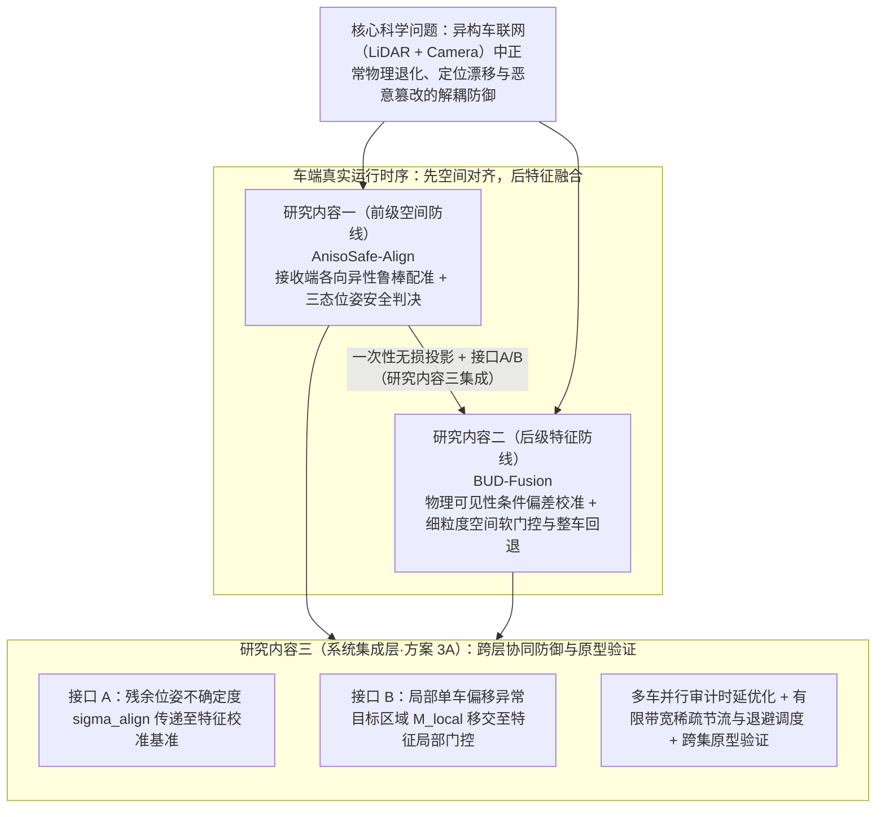

# 面向异构车联网协同感知的安全防御关键技术研究
## —— 硕士学位论文总体研究方案 v6（物理时序重排与 9 项跨模态冻结实测完备版）

> [!IMPORTANT]
> **版本更新说明（v6 定稿）**：本版本与最新开题汇报架构 100% 对齐，基于在真实 OPV2V 跨模态异构底座（`HEAL` `m1` 64 线 LiDAR + `m2` 4 路环视 Camera-LSS）上完成冻结并提交 Git 溯源的 **9 项 Dev-320 核心实测实验**（Git 溯源至 `6366a90`）同步修订：
> 1. **总题目与章节顺序重构**：题目定稿为**《面向异构车联网协同感知的安全防御关键技术研究》**（规避与大模型领域的“安全对齐”歧义）；全篇三大研究内容严格按车端真实物理流水线重排为**研究内容一（前级空间防线：跨模态恶意位姿检测与鲁棒对齐 `AnisoSafe-Align`）→ 研究内容二（后级特征防线：跨模态异构车队的可信特征融合 `BUD-Fusion`）→ 研究内容三（系统集成层：异构协同感知可信防御系统设计与验证）**；
> 2. **学术术语全面规范化**：攻击名称全部采用协同感知安全顶会标准中英文表述（全局特征对抗扰动 `Global PGD`、定向目标移除 `Targeted Object Removal`、虚假目标伪造 `Targeted Object Fabrication`、遮挡区目标伪造 `Occluded-Region Fabrication`、近场目标移除 `Near-Field Removal`、恶意自身位姿虚报 `AdvGPS`、局部目标位置偏移 `PosePert`）；全文摘除“开放异构”“干净/良性”“像素级”“刚性/非刚性”“异常掩膜”等易歧义或翻译腔表述；
> 3. **核心动机与公平对照升级**：完整展示 `ROBOSAC` 与调参 `HetShield-Tuned` 在无攻击异构下零掉点（`92.2%`）却在攻击下全线失守的“保无攻击 vs 防攻击”死锁实证，以及与阈值无关的跨模态正常异常分分布错位；
> 4. **完整纳入全部 9 项实测成果**：涵盖研究内容一真实跨模态各向异性定位误差实测（`step6_aniso`）与数值仿真预验证，以及研究内容二 `step5_4` 定向攻击成功率 `ASR`、`step5_2 mixed` 混合多车队 9 方法全基线、`step4_4 / step4_5 / step5_1 / step5_3 / step7_latency / step6_probe_m3` 全部冻结硬数据。

---

## 0. 全篇定位、核心科学问题与三点递进体系

### 0.1 核心科学问题与差异化立论边界
* **核心科学问题**：在**冻结本车基准感知模型、无需攻击样本参与训练（Attack-Agnostic Calibration）且满足车载 10 Hz（`< 100 ms`）实时性要求**的前提下，如何在激光雷达与环视摄像头混合的异构车联网中，按真实车端运行时序分别在**跨模态空间坐标对齐层**与**中层协议特征融合层**解耦传感器的正常物理退化、正常定位漂移与多类型恶意篡改，并实现两层防线的跨层协同防御与实时系统部署？
* **差异化科研边界**：
  1. **问题立论差异**：现有协同感知安全防御（如 `ROBOSAC`、`LUCIA`、`CP-Guard`、`CP-uniGuard`、`HetShield`）普遍采用**跨模态统一判据或整车级粗粒度剔除**，未考虑激光雷达与摄像头天然迥异的正常观测误差分布与空间可见性非对称性；即便在 `HEAL` 对齐后的共享特征空间中，现有方法仍深陷**“严格门限误杀诚实摄像头车与盲区补全车 vs 放宽门限漏放雷达攻击者与局部定向篡改”**的死锁（已在 Dev-320 上通过无阈值分布与端到端融合结果双重实证）；
  2. **方法路径边界**：不依赖路侧基础设施（2 车及以上即可独立运行），不采信协作者自报方差，所有条件标定、各向异性建模与安全判据均由可信本车接收端基于离线无攻击数据与本车物理射线观测独立完成。

### 0.2 全篇三点研究内容关系与叙事递进逻辑

论文严格遵循车端真实数据流与“先空间防线 → 再特征防线 → 最后跨层系统联动”的递进逻辑：

* **研究内容一（前级空间防线：`AnisoSafe-Align`，已完成真实跨模态各向异性误差实测与数值仿真预验证）**：面向跨模态空间对齐阶段，针对实测中摄像头高达激光雷达 **7.2 倍**的远距径向定位误差及 GNSS 漂移 / `AdvGPS` / `PosePert` 位姿攻击，建立接收端独立的极坐标各向异性鲁棒配准与融合持续偏置检验的三态位姿安全判决机制；
* **研究内容二（后级特征防线：`BUD-Fusion`，已完成 8 项跨模态 Dev-320 冻结验证）**：面向已完成空间对齐后的中层共享协议特征融合阶段，通过**物理可见性感知的条件偏差校准**与**细粒度空间软门控 + 整车级高门限回退**，在保护诚实异构车盲区补全增益的同时精准拦截全局与定向局部特征篡改；
* **研究内容三（系统集成层，方案 3A）**：将研究内容一（前级空间防线）与研究内容二（后级特征防线）紧耦合集成，设计**残余配准不确定度传递（接口 A）**与**异常目标区域移交（接口 B）**，并面向时延与带宽约束构建可信协同调度机制，完成复合攻防与跨数据集原型验证。

---

## 1. 研究背景、文献核查与立足点实证

### 1.1 研究背景与两阶段混叠矛盾
在真实智能网联交通流中，协同车辆搭载的传感器与感知骨干呈显著跨模态异构性（如 64 线激光雷达 `PointPillars` 与 4 路环视摄像头 `Camera-LSS` 并存）。本车融合协作者共享的鸟瞰图（BEV）协议特征需依次经历**空间坐标对齐**与**中层特征融合**两个阶段：
1. **空间对齐阶段（研究内容一核心矛盾）**：摄像头依赖单目透视估计深度导致定位误差呈强烈**极坐标各向异性**（在 OPV2V Dev-320 上实测：45~60 m 处摄像头径向标准差达 **`2.238 m`**，为横向误差的 `1.65×`、激光雷达径向误差的 **`7.2×`**）。该误差与正常 GNSS/IMU 定位漂移、恶意自身位姿虚报（`AdvGPS`）及局部单车位置偏移（`PosePert`）深度纠缠，传统各向同性配准极易被视觉深度模糊拉偏，且仅靠常规位置残差难以区分正常漂移与恶意位姿伪造。
2. **特征融合阶段（研究内容二核心矛盾）**：即使完成空间坐标对齐并通过 `HEAL` 映射至同维共享 BEV 协议特征，由于传感器物理成像机理迥异（激光雷达测距精准但受遮挡与远距点云稀疏限制；环视摄像头受深度估计模糊影响，正常特征一致性均值仅 `0.390`，远低于激光雷达的 `0.881`），现有防御采用统一判据与整车级剔除必然陷入**“严格门限大比例误杀诚实摄像头车与盲区补全车 vs 放宽门限漏放雷达攻击者与定向局部篡改”**的两难死锁。

### 1.2 国内外研究现状与关键文献源码核实

| 技术脉络 | 代表性文献 | 核心思路与局限定位（含源码级核查） |
| :--- | :--- | :--- |
| **1. 协同感知位姿配准与位姿攻防** | **正常误差配准**：`CoAlign` (ICRA'23), `FeaCo` (ACM MM'23), `RoCo` (ACM MM'24), `V2VLoc` (AAAI'26) **视觉深度不确定性**：`CoCam4D` (arXiv:2610.11577) **恶意位姿攻击**：`AdvGPS` (ICRA'24), `PosePert` (arXiv:2605.01301) | `CoAlign / RoCo / V2VLoc` 采用各向同性残差且默认误差为零均值正常噪声，既易被摄像头远距径向模糊拉偏，也无法识别恶意位姿虚报或区分整车虚报与局部单车偏移；`CoCam4D` 面向纯视觉单模态且依赖协作者自报方差、易被攻击者伪造。 |
| **2. 异构协同感知特征对齐底座** | `Where2comm` (NeurIPS'22), `MPDA` (ICRA'23), `HEAL` (ICLR'24，开放异构对齐框架), `PnPDA` (ECCV'24), `STAMP` (ICLR'25), `PolyInter` (CVPR'25), `NegoCollab` (NeurIPS'25), `GT-Space` (ICLR'26), `HERO` (ECCV'26), `CoDS` (IEEE TMC'26) | 解决了跨传感器/跨骨干的特征空间对齐与无攻击高精度融合问题（如 `HEAL` 在 OPV2V 上无攻击 3 车融合可达 `92.2%` AP@0.5）。**共同缺口**：均假设协作者诚实，面对对抗特征篡改时感知精度迅速崩塌。 |
| **3. 协同感知特征安全防御** | **同构安全代表**：`ROBOSAC` (ICCV'23), `CP-Guard` (AAAI'25), `LUCIA` (USENIX Security'25), `CP-uniGuard` (arXiv:2506.22890) **异构安全探索**：`HetShield` (arXiv:2609.17856) | • **`ROBOSAC` / `CP-Guard`**：依赖 ≥3 车子集共识采样，2 车异构失效；实测 `ROBOSAC` 在 3~6 车无攻击下零掉点（`92.2%`），但对局部定向攻击几乎漏防（ASR `57.9% / 95.7%`）且时延达 `190.9 ms`（P95 `403.7 ms`）； • **`LUCIA`**：基于集群中位数分配信任权，同帧内对诚实雷达车信任高达 `97.4%`，却把诚实摄像头车误判为离群点（信任均值腰斩至 `39.4%`、中位数 `15.5%`），导致 4~6 车无攻击 AP 暴跌 `-12.3%`； • **`CP-uniGuard`（源码核查 `adaptive_threshold.py` L42–46, L110–126）**：双滑窗仅维护单一全局标量门限，不按传感器类型或观测条件分档； • **`HetShield`**：在 `FIT-11` 上重训 64ch ConvGRU 后，无攻击下诚实 `m2` 异常分均值 `0.379` 仍远高于诚实 `m1` 的 `P95 = 0.297`：用原论文阈值 `0.30` 误杀诚实 `m2` 达 `98.1%`，调参放宽保无攻击（`92.2%` 零掉点）后面对雷达全局 PGD 直接崩至 `14.9%`、定向攻击 ASR 高达 `57.9% / 95.9%`。 |

---

## 2. 研究内容一：跨模态恶意位姿检测与鲁棒对齐方法（`AnisoSafe-Align`）

> **独立实验边界与进展说明**：研究内容一聚焦**前级空间坐标对齐安全**，针对协作者广播位姿误差与恶意位姿虚报导致的跨模态错位，在摄像头远距测距不准的干扰下实现准确的空间对齐与恶意位姿安全拒止。当前已在真实 OPV2V Dev-320 数据上完成了 `m1/m2` 框中心误差的径向/横向分解实测（`step6_aniso`），并完成了 250~400 次蒙特卡洛数值仿真预验证。

### 2.1 系统模型、威胁模型与诚实能力边界
* **系统模型**：本车（64 线 LiDAR）定位与检测框中心集合 $\mathcal{D}_0 = \{q_m\}$ 可信；异构协作者广播局部协议特征 $Z_i^{\text{local}}$、声称位姿 $T_i^{\text{rep}} = (x_i, y_i, \theta_i)$ 及公开传感器类型 $m_i$。接收端不采信协作者自报方差，直接在局部特征上复用冻结检测头抽框 $\mathcal{D}_i^{\text{loc}}$ 完成配准与判决，通过后再执行**一次性无损特征投影**（消除二次插值模糊）。
* **五类位姿异常与攻击**：① 正常 GNSS/IMU 定位噪声（$\sigma_p \in \{0.2, 0.4, 0.6\}\text{ m}, \sigma_\theta \in \{0.5^\circ, 1.0^\circ, 2.0^\circ\}$）；② 中大幅及极端 `AdvGPS` 全局自身位姿虚报（`1.5~8.0 m / 3°~35°`）；③ 亚米级持续定向偏置（`0.5~0.8 m`）；④ 沿信息矩阵最小特征向量 $v_{\min}$ 的弱观测方向白盒自适应偏移；⑤ 局部目标位置偏移（`PosePert` 复合攻击）。
* **诚实能力边界**：仅篡改纯盲区目标、极端窄锥共线（$\pm 12^\circ$）下的单帧微幅 $v_{\min}$ 偏移、以及无共视前景目标帧（$N_{\text{covis}} = 0$）属于几何配准原理边界，分别由信息矩阵条件数诊断、延长跨帧滑窗与保守退化策略刻画。

### 2.2 拟创新点（2 项）
1. **创新点 1.1：接收端独立的跨模态各向异性鲁棒配准方法**  
   不采信协作者自报方差，由接收端仅依据传感模态与目标距离独立构建沿协作者视线方向“径向宽容、横向收紧”的极坐标误差模型，结合信息矩阵可观测度诊断与渐进非凸鲁棒优化（GNC-TLS + MAP 阻尼），消除视觉远距深度误差与离群偏移车对空间配准的干扰。
2. **创新点 1.2：融合持续偏置检验的三态位姿安全判决机制**  
   联合单帧全局位姿偏移量、防污染的跨帧世界系持续偏置检验与当前帧一致内点残差，实现三态精准分流——正常定位偏差自动纠偏（`ALIGN`）、恶意全局位姿虚报直接拒止（`REJECT`）、局部单车位置偏移标出异常目标区域并移交下游拦截（`LOCAL_FLAG`）。

### 2.3 模块 1.1：接收端独立的跨模态各向异性建模与鲁棒 $SE(2)$ 配准
1. **极坐标各向异性协方差（已由 `step6_aniso` 实测验证）**：对协作者局部系候选框中心 $(d_n, \theta_n)$，仅按公开传感器类型 $m_i$ 与离线冻结标定曲线构造联合协方差（摄像头径向误差远大于横向且随距离单调剧增；激光雷达各向近同性且稳定在 `0.17~0.33 m`）：
   $$\Sigma_n = R(\theta_n)\,\text{diag}\!\big(\sigma_r^2(d_n, m_i),\; \sigma_t^2(d_n, m_i)\big)\,R(\theta_n)^\top + \sigma_{\text{ego}}^2 I_2$$
2. **粗到精截断马氏共识关联 + 鲁棒优化求解**：在候选位姿集合 $\mathcal{H}$ 上以截断卡方共识分选初值 $\Delta T_0$，执行带卡方截断的匈牙利匹配得当前帧匹配集 $\mathcal{M}_{\text{cur}}$；计算初始 Fisher 信息矩阵 $H_{\text{obs}} = \sum J_k^\top \Sigma_k^{-1} J_k$ 与条件数 $\kappa(H_{\text{obs}})$ 诊断弱观测风险，结合 **GNC-TLS 渐进非凸红降权**（抑制 30% 局部偏移外点）与 **观测度感知 MAP 阻尼**（防止 1~2 车稀疏帧发散）求解校正量 $\hat{\Delta T}_i$；最终残差严格仅在当前帧 $\mathcal{M}_{\text{cur}}$ 计算。

### 2.4 模块 1.2：三态位姿安全判决与防污染世界系持续偏置检验
基于单帧全局位姿偏移统计量 $s_i^{\text{global}}$、当前帧局部目标偏移残差统计量 $s_i^{\text{local}} = \alpha_{\text{in}}(1 - \rho_{\text{in}}) + \alpha_{\text{res}}\min(e_{\max}^2, e_{\text{cap}})$ 及世界系短窗均值 $s_i^{\text{persist}} = \|\frac{1}{L}\sum \hat{\Delta t}_{w,i}^{(t-\ell)}\|_2$（全部门限仅在验证集正常漂移 95% 分位数冻结），按严格先后顺序判决：
1. **Step 1（单帧大幅/超界拒止）**：$s_i^{\text{global}} > \tau_{\text{global}}$ 或内点率 $\rho_{\text{in}} < \rho_{\min}$ → **`REJECT`**（不写入历史窗口 `valid_buf`，防滑窗污染，免除后续特征投影）；
2. **Step 2（持续亚米级微偏置拒止）**：$s_i^{\text{persist}} > \tau_{\text{persist}}$ → **`REJECT`**（同样不入窗）；否则将 $\hat{\Delta t}_{w,i}$ 写入 `valid_buf`；
3. **Step 3（局部单车偏移异常分离）**：$s_i^{\text{local}} > \tau_{\text{local}}$ → **`LOCAL_FLAG`**（执行一次性无损投影并输出偏移车对应的异常目标区域）；否则 **`ALIGN`**（按校正位姿一次性投影进入后级融合）。

---

## 3. 研究内容二：跨模态异构车队的可信特征融合方法（`BUD-Fusion`）

> **独立实验边界与冻结状态**：研究内容二聚焦**后级中层协议特征融合安全**，在完成空间对齐的设定下，基于冻结官方跨模态多尺度底座 **`HEAL`**（本车 `m1` 64 线 LiDAR-PointPillars；协作者为 `m1` 64 线 LiDAR 与 `m2` 4 目环视 Camera-LSS；传输层协议特征 `heter_feature_2d ∈ R^{64×256×256}`，物理范围 `[-102.4, 102.4]^2 m`，分辨率 `0.8 m`）独立完成建模、冻结标定与全维度验证。全部参数仅在严格互斥的 `FIT-11` 序列无攻击数据上离线标定（Attack-Agnostic），零攻击样本训练。

### 3.1 威胁模型与信任边界
* **可信计算基（TCB）**：本车（`i = 0`，64 线 LiDAR 与冻结 `HEAL` 主干/金字塔/检测头）本地观测与融合推理可信；
* **攻击面（传输层协议特征篡改）**：恶意协作车（可为 `m1` 或 `m2`，涵盖单攻击者及 ≥4 车场景双攻击者）直接篡改发送的协议特征 `heter_feature_2d`，覆盖 **6 类标准与针对性攻击**：
  1. **全局特征对抗扰动攻击（Global PGD Feature Perturbation）**：按本车特征标准差缩放 `0.5σ / 1.0σ / 2.0σ` 及强预算 `ε = 4.0`；
  2. **定向目标移除攻击（Targeted Object Removal Attack, `1.0σ`）**：仅篡改 2 个真实目标周围 `5×5` 网格微簇以隐蔽擦除前景车辆；
  3. **虚假目标伪造攻击（Targeted Object Fabrication Attack, `2.0σ`）**：在 2 处空旷区注入虚假目标特征块诱导误检；
  4. **遮挡区目标伪造攻击（Occluded-Region Object Fabrication, `2.0σ`）**：攻击者刻意仅在本车激光射线被遮挡区域伪造车辆，专门检验盲区保护机制是否留有安全后门；
  5. **近场目标移除攻击（Near-Field Object Removal, `0–6 m, 2.0σ`）**：针对摄像头 LSS 近场奇异高幅带发起擦除，验证 0–6 m 独立成档不豁免的安全性；
  6. **混合多车队单/双攻击者压测**：在 3~6 车混合车队中随机指定 1 名（分报攻击 `m1` / `m2`）或 2 名并发攻击者。

### 3.2 核心创新点（2 项）
1. **创新点 2.1：物理可见性感知的条件偏差校准方法**  
   针对异构车队统一判据导致跨模态分布错位与诚实补盲误杀的矛盾，由本车接收端独立构建四维条件校准空间：**传感器模态（`m1 / m2`）× 协作者距离 5 档（`[0,6), [6,15), [15,30), [30,45), [45,∞) m`）× 本车物理预期激光点数可见性 3 档（`Clear / Sparse / Occluded`）× 前景/空地响应（`fg / bg`）**。通过物理可见性精确划分消除远距稀疏车误杀；通过在门控标定中分离前景格与空地格统计无攻击分位数，根治遮挡区大量空地网格压低门限引发的诚实补盲误判，并同步提升遮挡区目标伪造的检出能力。
2. **创新点 2.2：细粒度空间软门控与整车回退融合机制**  
   联合多尺度金字塔余弦偏差 `(d_cos0, d_cos1, d_cos2)` 与 5×5 位置容差有向语义偏差 `(d_drop_tol, d_add_tol)`，显式区分「共视区目标移除」与「遮挡区诚实补盲 / 空地目标伪造」，以可见性感知加权 `gamma_add = [1.0, 0.3, 0.0]` 与条件余弦死区生成细粒度空间软门控 `gate_L0`，在不牺牲协作者其余诚实区域补盲增益的前提下精准屏蔽局部篡改；叠加基于条件 `div_p95` 帧级异常分与高安全门限 `frame_high_tau` 的**整车级回退托底**，在全局强 PGD 攻击下精准隔离，在无攻击与定向局部攻击下保持零/极低误触发。

### 3.3 核心方法实现细节（与冻结代码 100% 对齐）
1. **物理预期激光点数可见性分档（`step4_1_v2_core.py`）**：
   - 在本车 64 线激光雷达 `360°` 极角扇区内提取障碍物高度层 `z ∈ [-1.30 m, +0.85 m]`（过滤地面与本车 `r ≤ 2.4 m`）的近端遮挡距离包络 $r_{\text{occ}}(\theta)$，计算视线无遮挡因子：
     $$\text{los}(x,y) = \exp\!\left(-\frac{\max\big(0,\; r(x,y) - (r_{\text{occ}}(\theta) + \Delta_{\text{margin}})\big)}{3.0}\right)$$
   - 解析计算穿过标准车辆（高 $1.55\text{ m}$ × 宽 $2.0\text{ m}$）的本车预期激光点数 $N_{\text{exp}}(x,y) = n_{\text{beam}}^{\text{vis}}(x,y) \cdot n_{\text{horiz}}(x,y)$，严格划分三档可见性：
     - **`Occluded`（遮挡）**：$\text{los}(x,y) < 0.50$；
     - **`Clear`（清晰）**：$\text{los}(x,y) \ge 0.50$ 且 $N_{\text{exp}}(x,y) \ge \tau_{\text{pts}}$（`FIT-11` 标定冻结为 **`73.85` 点**，对应约 `40 m`）；
     - **`Sparse`（稀疏）**：$\text{los}(x,y) \ge 0.50$ 且 $N_{\text{exp}}(x,y) < \tau_{\text{pts}}$。
2. **多尺度余弦 + 5×5 位置容差有向语义偏差（`bud_fusion_heal.py`）**：
   - 提取金字塔 L0/L1/L2 三层仿射对齐后的逐网格余弦偏差 $(d_{\cos,0}, d_{\cos,1}, d_{\cos,2})$ 与融合前景概率变化 $d_{\text{sem}} = |p_{\text{ego}} - p_{\text{fused}}|$；
   - 引入 $5\times 5$（$\pm 1.6\text{ m}$）位置容差池化吸收正常跨模态微小定位错位，构造方向分离的目标移除项与目标新增项：
     $$d_{\text{drop}}^{\text{tol}} = \max\!\big(0,\; p_{\text{ego}} - \text{MaxPool}_{5\times 5}(p_{\text{fused}})\big), \qquad d_{\text{add}}^{\text{tol}} = \max\!\big(0,\; p_{\text{fused}} - \text{MaxPool}_{5\times 5}(p_{\text{ego}})\big)$$
3. **前景/空地双分档余弦死区软门控 + 整车级高门限回退**：
   - 按协作者融合显著度 $\text{MaxPool}_{3\times 3}(p_{\text{fused}}) > 0.20$ 将网格分为前景格（`fg`）与空地格（`bg`），在 `FIT-11` 上分别查表 `(mod, vis)` 无攻击余弦分位门限（冻结选用 `bg: p99.9`、`fg: p98.0`），与有向语义超界量合并后经半径 `r_dil = 3` 膨胀得细粒度空间软门控 $g_i(x,y) = \exp(-\beta \cdot E_{\text{dil}}(x,y)) \in (0, 1]$（冻结 `β = 3.5`），多尺度乘入协作者融合权重；
   - 计算条件标准化且经 `FIT-11` 无攻击 `p95` 归一化的帧级异常分 $s_i^{\text{T4}}$：若 $s_i^{\text{T4}} > \tau_{\text{high}}(m_i)$（冻结 `m1 = 1.495`、`m2 = 1.610`，无攻击 Fit-100 误触发 `0.0%`），触发整车级回退，否则维持精准局部门控。
4. **工程可扩展性与补充探索说明**：
   - 接入新传感器类型时，仅需利用该模态少量无攻击样本离线补充条件分位数表，无需重新训练主干网络或采集攻击样本；
   - 前期在纯 LiDAR 四异构底座验证的发送端谱约束适配器 `LB-FPA`（将 16 线最坏扰动放大率由 `11.52×` 压至 `0.712×`）作为发送端表征稳定性补充实验保留。

---

## 4. 研究内容三：异构协同感知可信防御系统设计与验证（方案 3A）

> **设计原则**：按真实车端运行时序将研究内容一（前级空间防线）与研究内容二（后级特征防线）紧耦合集成；所有跨层联动接口与系统级资源调度均在本章设计，保持前两章各自独立可验证。

### 4.1 拟创新点（2 项）
1. **创新点 3.1：面向复合威胁的空间与特征跨层协同防御机制**  
   打通前级空间对齐与后级特征融合间的信息隔离，针对“位姿微偏 + 特征篡改”和“正常位姿 + 局部单车偏移”等复合攻击，设计残余配准不确定度传递（接口 A）与异常目标区域移交（接口 B），实现跨层误差隔离与异常定向联动压制。
2. **创新点 3.2：面向时延与带宽约束的可信协同调度机制**  
   锚定车载 10 Hz 实时红线与有限 V2X 通信带宽，构建多协作者批量张量并行审计、残余权重向高信任诚实车重分配、以及基于前景显著度稀疏化与恶意节点静默退避的自适应通信调度，保障多车高并发下系统稳定满足实时与低带宽约束。

### 4.2 关键系统接口与工程优化设计
1. **紧耦合在线流水线与恶意退避**：发送端广播局部协议特征与声称位姿 → 接收端复用冻结检测头局部抽框 → `AnisoSafe-Align`（研究内容一）三态判决（`REJECT` 零投影早停并触发连续恶意静默退避；`ALIGN / LOCAL_FLAG` 执行一次性无损投影）→ `BUD-Fusion`（研究内容二）条件校准与细粒度软门控融合 → 单次前向输出最终 3D 框。
2. **两项跨层核心接口**：
   - **接口 A（残余配准不确定度向下游传递）**：将 `AnisoSafe-Align` 放行后的残余位姿协方差 $\Sigma_{\text{pose},i} \approx (H_{\text{obs}} + \Lambda_{\text{prior}})^{-1}$ 经局部坐标雅可比映射为空间保护方差 $\sigma_{\text{align},i}^2(x,y)$，叠加至 `BUD-Fusion` 特征偏差校准基准（严格保持与待检特征内容梯度隔离），缓解窄锥微残差诱发的跨模块连锁误报；
   - **接口 B（局部偏移异常目标区域定向移交）**：面对“正常位姿 + `PosePert` 局部目标偏移”复合攻击，将 `LOCAL_FLAG` 检出的异常目标膨胀区域 $\mathcal{M}_{\text{local},i}(x,y)$ 直接乘入 `BUD-Fusion` 细粒度空间软门控 $g_i^{\text{sys}} = g_i \cdot (1 - \eta_{\text{loc}}\mathcal{M}_{\text{local},i})$，定向压制偏移目标同时完整保留其余区域补盲增益。
3. **面向实测瓶颈的实时性与带宽工程优化**：
   - **时延优化（锚定 `step7_latency` 实测数据）**：当前 `BUD-Fusion` 在 RTX 4090 上端到端单帧均值 **`69.89 ms`**（1 协作车 `48.02 ms` / 2 协作车 `73.45 ms`），已满足 10 Hz (`< 100 ms`) 要求；实测拆解显示逐车特征审计 `T_audit_dev` 占 `40.67 ms`（58.2%）。研究内容三将通过**多协作者批量张量并行审计**、**多车残余权重向其余高信任协作者重分配**（改进 4~6 车无攻击场景权重回流问题）与**冻结检测头特征共享复用**，确保多车紧耦合端到端稳定远低于 `100 ms`；
   - **有限带宽协同**：结合前景显著度稀疏过滤、量化压缩与恶意节点退避节流，验证 `1~20 Mbps` 带宽预算下的精度—通信权衡，并在 **V2V4Real** 上开展跨数据集原型验证。

---

## 5. 已有实测成果、仿真预验证与后续实验规划

> **实验条件与严格隔离声明**：跨模态主线全部 19 条完整 4 相机序列（3,536 帧）按父序列严格互斥划分为 `FIT-11`（11 序列 2,312 帧，仅无攻击数据标定与训练，零攻击训练）与 `DEV-8`（Dev-320，8 条未见序列 320 帧，含 **583 辆纯他车客观盲区 GT**）；独立验证集 `opv2v_val`（6 序列 965 帧）仅留作封测前外部门限重标定；测试集 **`opv2v_test`（16 序列 2,170 帧）目前绝对封存未触碰**。所有核心对比报告 2,000 次按父序列 Block-Bootstrap 95% CI，结果 JSON 均绑定 Git commit 并同步至 [E:/BUD/results_rq1_v2_mm](file:///E:/BUD/results_rq1_v2_mm)。

### 5.1 第一类：跨模态异构主线 Dev-320 已完成硬核实测（9 项全部落盘提交）

#### （1）研究内容一核心物理依据：跨模态各向异性定位误差实测（`step6_aniso`，提交 `9e35285`）
在 Dev-320 全部 8 条未见序列上，基于真实冻结 `HEAL` 检测框匹配 `m1`（3,407 框）与 `m2`（2,096 框），沿协作者视线方向分解径向与横向误差：
* **64 线激光雷达（`m1`）**：各向近同性且随距离高度稳定，全距离段定位标准差稳定在 **`0.17~0.33 m`**；
* **4 目环视摄像头（`m2`）**：呈强烈极坐标各向异性并随距离单调剧增——45~60 m 处径向标准差飙升至 **`2.238 m`**（横向 `1.354 m`，各向异性比 `1.65×~2.01×`，达 `m1` 径向误差的 **`7.2×`**），线性拟合决定系数 **`R² = 0.9866`**，直接为研究内容一“径向宽容、横向收紧”的接收端独立极坐标误差模型提供了实测定量依据。

#### （2）研究内容二核心立足点实证：“保无攻击 vs 防攻击”死锁与分布错位（`step5_3` + `step5_1`，提交 `efe8a22` / `b00a36e`）
* **与阈值无关的跨模态分布错位事实**：在无攻击 Dev-320 上，经 `FIT-11` 重训的 `HetShield`（64ch ConvGRU）对诚实 `m1` (LiDAR) 异常分均值仅 **`0.171`**（`P95 = 0.297`，`Max = 0.347`），而对诚实 `m2` (Camera) 均值高达 **`0.379`**（`P95 = 0.438`，`Max = 0.482`），根因是跨模态一致性 `sigma_k` 上 `m1 = 0.881` 而 `m2 = 0.390`。两分布本质错位导致**任意单一全局阈值**均无解：阈值卡在 `0.30` 则诚实 `m2` 误报 **`98.75%`**；阈值放宽至压低 `m2 ≤ 5%`（`0.438`）则 `m1` 攻击者在三类攻击下检出率全部归零 **`0.00%`**。
* **同帧内部对照证实复现公平、不存在调参偏见**：在无攻击 ≥3 车混合车队中，官方无参 `LUCIA` 对同帧诚实 `m1`（`n = 362`）给出高达 **`0.974`**（中位数 `1.000`）的正常高信任分，却对同帧诚实 `m2`（`n = 440`）腰斩至 **`0.394`**（中位数仅 **`0.155`**）；与此同时，`ROBOSAC` 与调参放宽的 `HetShield-Tuned` 在 3 车无攻击异构车队中均取得 **`92.2%` 零掉点满血精度**，却分别在局部定向攻击（ASR `57.9% / 95.7%`）和雷达全局 PGD（AP 崩至 `14.9%`）下全面失守。
* **按条件判据（`Tier ④`）突破两难**：在双模态均控 `5.0%` 误报口径下，本文方法实现 `m1 = 5.0%`、`m2 = 5.0%` 完美对称，同时保持全局 PGD 检出 `79.4% / 83.4%`、定向目标移除检出 `70.0% / 71.6%`（详见 [step5_3 JSON](file:///E:/BUD/results_rq1_v2_mm/step5_3_hetero_unified_threshold_evidence.json)）。

#### （3）研究内容二单协作者全 9 工况端到端验收：`step4_5`（提交 `7cba037`，[报告](file:///E:/BUD/results_rq1_v2_mm/step4_5_bud_frozen_320_report.json)）
单车基准 `Ego-Only`：**`AP@0.5 = 68.98%`**（`95% CI [62.30%, 85.15%]`），`AP@0.7 = 60.85%`。
* **无攻击性能全面达标（远优于盲区召回损失 ≤ 3% 目标）**：`m1` 无攻击 AP@0.5 `-0.30%`、盲区召回 **`-0.52%`**（`82.85% → 82.33%`）；`m2` 无攻击 AP@0.5 `-0.45%`、盲区召回 **`+0.34%`**（`33.79% → 34.13%`）；整车回退无攻击误触发率双双 **`0.0%`**。
* **消融净收益**：① 物理可见性分档（`Tier ④ vs ②`）使 ≥2 辆盲区补全帧误报率由 `5.94% → 1.98% (m1)`、`6.52% → 0.00% (m2)`；② 前景/空地双分档使 `m1` 遮挡区目标伪造 AUROC 从 `0.8627` **反升至 `0.9077`**；③ 整车级回退（`BUD-Frozen vs LocOnly`）在强全局 PGD 下额外挽回 **`+3.5% ~ +6.0%`** AP@0.5。

| 模态 | 工况（回退率） | `No-Def` AP50 | `WholeDrop` AP50 | **`BUD-Frozen` AP50** | `BUD vs WholeDrop` (95% CI) | 盲区召回 (`NoDef` / `WholeDrop` / **`BUD`**) |
| :--- | :--- | :---: | :---: | :---: | :---: | :---: |
| **`m1`** | `Clean` (0.0%) | `82.53%` | `82.35%` | **`82.23%`** | `-0.12%` | `82.85%` / `81.30%` / **`82.33%`** |
| **`m1`** | `Global PGD 1.0σ` (60.3%) | `28.73%` | `66.51%` | **`66.58%`** | `+0.07% [-1.11%, +2.21%]` | `1.54%` / `0.17%` / `1.71%` |
| **`m1`** | `Global PGD ε=4.0` (67.8%) | `20.25%` | `66.73%` | **`66.13%`** | `-0.60%` | `0.34%` / — / `0.52%` |
| **`m1`** | `Object Removal 1.0σ` (16.6%) | `77.61%` | `70.65%` | **`78.64%`** | **`+7.99% [+4.96%, +9.77%]`** | `80.96%` / `19.73%` / **`66.04%`** (`+46.3%`) |
| **`m1`** | `Object Fabrication 2.0σ` (1.6%) | `75.88%` | `72.29%` | **`79.49%`** | **`+7.20% [+5.61%, +7.95%]`** | `82.85%` / `43.91%` / **`82.33%`** (`+38.4%`) |
| **`m1`** | `Occluded Fabrication 2.0σ` (0.0%) | `73.92%` | `71.60%` | **`78.65%`** | **`+7.05% [+5.21%, +7.87%]`** | `82.50%` / `45.28%` / **`81.99%`** (`+36.7%`) |
| **`m1`** | `Near-Field Removal 0–6m` (13.4%) | `78.10%` | `74.76%` | **`80.02%`** | **`+5.26% [+2.89%, +6.38%]`** | `76.50%` / `48.71%` / **`72.21%`** (`+23.5%`) |
| **`m2`** | `Clean` (0.0%) | `73.51%` | `73.51%` | **`73.06%`** | `-0.45%` | `33.79%` / `33.79%` / **`34.13%`** |
| **`m2`** | `Global PGD 1.0σ` (63.1%) | `22.28%` | `65.47%` | **`63.62%`** | `-1.84% [-2.76%, -0.16%]` | `2.23%` / `0.00%` / `1.20%` |
| **`m2`** | `Global PGD ε=4.0` (66.6%) | `18.28%` | `66.43%` | **`64.81%`** | `-1.62%` | `1.20%` / — / `0.52%` |
| **`m2`** | `Object Removal 1.0σ` (3.8%) | `67.55%` | `68.54%` | **`72.18%`** | **`+3.64% [+3.13%, +4.48%]`** | `33.11%` / `11.66%` / **`32.59%`** (`+20.9%`) |
| **`m2`** | `Object Fabrication 2.0σ` (2.8%) | `67.19%` | `68.43%` | **`70.76%`** | **`+2.33% [+1.31%, +3.59%]`** | `33.62%` / `25.90%` / **`33.62%`** (`+7.7%`) |
| **`m2`** | `Occluded Fabrication 2.0σ` (0.0%) | `64.70%` | `66.02%` | **`68.84%`** | **`+2.81% [+1.75%, +5.04%]`** | `33.45%` / `31.39%` / **`33.79%`** (`+2.4%`) |
| **`m2`** | `Near-Field Removal 0–6m` (2.8%) | `69.22%` | `69.87%` | **`72.26%`** | **`+2.39% [+1.63%, +3.80%]`** | `29.16%` / `26.41%` / **`29.85%`** (`+3.4%`) |

#### （4）研究内容二混合多车队 9 方法全基线分层主实验：`step5_2 mixed`（提交 `c07b239`，[报告](file:///E:/BUD/results_rq1_v2_mm/step5_2_mixed_report.json)）
* **同帧诚实车保护**：`BUD-Fusion` 双模态诚实车 FPR 对称可控（`m1 = 4.42%`、`m2 = 3.33%`，整车回退误触发双双 **`0.00%`**），一辆车被攻击时同帧其他诚实车融合权重变化仅 **`-0.0003 (m1) / -0.0007 (m2)`（零连坐）**；反观 `HetShield-Paper` 误报诚实 `m2` 达 **`98.13%`**，`LUCIA` 将同帧诚实 `m2` 权重暴砍 **`-36.4%`**。

| 混合车队分层与攻击场景 | `NoDef` | `WholeDrop` | **`BUD` (本文)** | `HS-Paper` | `HS-Tuned` | `HS-Per` | `LUCIA` | `ROBOSAC` |
| :--- | :---: | :---: | :---: | :---: | :---: | :---: | :---: | :---: |
| **`collab_1` \| `Clean`** | `94.69` | `94.69` | **`95.03`** | `90.57` | `94.57` | `94.57` | `87.93` | — |
| **`collab_1` \| `atk_m2 Object Removal / Fabrication`** | `85.1 / 86.3` | `88.0 / 86.5` | **`93.1 / 91.1`** | `89.6 / 89.7` | `85.3 / 86.3` | `85.3 / 86.3` | `87.9 / 87.9` | — |
| **`collab_2` \| `Clean`** | `92.23` | `92.00` | **`91.06`** | `89.70` | `92.24` | `89.87` | `88.05` | `92.23` |
| **`collab_2` \| `atk_m1 Removal / Fabrication`** | `87.8 / 84.2` | `79.9 / 82.6` | **`89.1 / 88.8`** | `88.5 / 86.4` | `87.9 / 84.3` | `88.9 / 86.9` | `85.3 / 82.8` | `87.8 / 84.3` |
| **`collab_2` \| `atk_m2 Removal / Fabrication`** | `86.3 / 85.4` | `89.3 / 87.9` | **`90.5 / 89.3`** | `89.6 / 89.3` | `86.4 / 85.6` | `84.8 / 83.9` | `86.4 / 85.9` | `86.4 / 85.5` |
| **`collab_2` \| `Global PGD 1.0σ (m1 / m2)`** | `14.8 / 35.4` | `76.5 / 86.6` | **`74.5 / 81.4`** | `63.0 / 88.3` | `14.9 / 38.4` | `70.8 / 36.6` | `22.1 / 71.0` | `80.1 / 89.7` |
| **`collab_ge3` \| `Clean`** | `89.42` | `89.19` | `85.41` | `82.49` | `89.36` | `82.61` | `77.16` | `89.42` |
| **`collab_ge3` \| `2 攻击者 Fabrication / Removal`** | `79.0 / 80.2` | `79.5 / 73.1` | **`83.6 / 82.1`** | `80.1 / 81.7` | `79.1 / 80.2` | `76.5 / 77.5` | `71.5 / 70.8` | `79.0 / 80.1` |
| **`collab_ge3` \| `2 攻击者 Global PGD 1.0σ`** | `8.68` | `64.64` | **`65.17`** | `65.11` | `9.14` | `37.78` | `14.46` | `68.28` |

> **诚实局限**：4~6 车无攻击场景（`collab_ge3 | Clean`）下，`BUD-Fusion` AP@0.5 降 `4.01%`（仍优于 `HetShield-Paper 82.49%` 与 `LUCIA 77.16%`），系多车削减权重累加回流本车空背景所致，已列为“残余权重向高信任诚实协作者重分配”的后续优化项。

#### （5）研究内容二定向攻击成功率（`ASR`）全基线分层主实验：`step5_4`（提交 `6366a90`，[报告](file:///E:/BUD/results_rq1_v2_mm/step5_4_targeted_asr_report.json)）
按协作车规模分类统计（Dev-320：1 协作车 41 帧 / 2 协作车 145 帧 / ≥3 协作车 4~6 车共 134 帧，匹配半径 `3.0 m`，`ASR` 越低越安全）：
* **3~6 车混合车队总汇（≥2 协作车, 279 帧）**：`ROBOSAC` 与调参 `HetShield-Tuned` 面对定向局部攻击几乎零防御（移除 `57.9%` / 伪造 `95.7%~95.9%`），`LUCIA` 为 `33.2% / 63.5%`，`WholeDrop` 为 `14.8% / 52.9%`；**`BUD-Fusion` 将目标移除 `ASR` 由 `58.6%` 暴降至 `4.3%`**（其中 `m1` 攻仅 **`1.4%`**），**将虚假目标伪造 `ASR` 由 `96.2%` 砍至 `32.1%`（全场最低）**；面对 4~6 车双攻击者并发攻击仍稳定压至 **`8.9% / 28.0%`**。
* **2 车异构对（1 协作车, 320 帧）**：`BUD-Fusion` 将 `m1/m2` 目标移除 `ASR` 压至 **`6.2% / 1.7%`**（无防御 `63.2% / 67.5%`），虚假目标伪造压至 **`55.5% / 44.7%`**（无防御 `96.7% / 96.1%`）。

#### （6）单帧耗时拆解与 `m3` 探路止损记录
* **单帧 CUDA Event 耗时拆解（`step7_latency`，提交 `f412474`，RTX 4090 独占 100 帧）**：`BUD-Fusion` 端到端均值 **`69.89 ms`**（P95 `79.29 ms`，1 车 `48.02 ms` / 2 车 `73.45 ms`），满足 10 Hz (`< 100 ms`) 实时要求（其中物理分档仅 `2.34 ms`、门控构建仅 `3.94 ms`），比 `ROBOSAC`（均值 `190.89 ms`，P95 `403.68 ms`）快 **`2.7×~5.1×`**；
* **`m3` 限时探路止损（`step6_probe_m3`，提交 `ece9a76`）**：SpConv 1.x/2.x 权重维度不兼容且 16/16 帧稀疏张量空报错，判定 `STOP_LOSS`，专注 `m1 + m2` 跨模态主线。

### 5.2 第二类：研究内容一数值仿真预验证与前期补充探索（独立归档）
1. **研究内容一（`AnisoSafe-Align`）Python 数值仿真预验证（250~400 次蒙特卡洛试验）**：各向异性配准降平移误差 `55%~61%`（`0.66/0.57 m → 0.26 m`）；`N=2` 稀疏帧 MAP 压至 `0.45 m`；33% 外点下 GNC-TLS 稳守 `0.34~0.37 m`；单核 CPU `5.3 ms/帧`；`AdvGPS` 检出 `AUROC 0.94~0.99`，局部目标偏移 `AUROC = 0.91`，持续 5 帧 `0.8 m` 偏置 `AUROC = 0.98`，窄锥 ±12° 弱观测方向单帧 `0.8 m` 偏移 `AUROC = 0.49`；
2. **前期纯 LiDAR 四异构 `LB-FPA` 150 帧探索**：将 16 线最坏扰动放大率由 `11.52×` 压至 `0.712×`（解析上界 `1.7965`）。

### 5.3 第三类：剩余待完成项与分阶段收口规划

| 阶段 | 待完成核心任务 | 当前状态与隔离规范 |
| :--- | :--- | :--- |
| **Phase 1（研究内容一实测）** | 依托已冻结的 `step6_aniso` 真实极坐标误差曲线，在真实 OPV2V + `HEAL` 框架上复现 `CoAlign` / `RoCo` 等基线，完成正常漂移、`AdvGPS`、沿 $v_{\min}$ 自适应偏移、持续微偏置与 `PosePert` 全套 5 类位姿攻防真实评测。 | 真实各向异性误差模型已实测冻结，配准与三态判决代码待接入真实数据集评测。 |
| **Phase 2（研究内容二终测收尾）** | 1. 落地多车残余权重向高信任诚实协作者重分配优化与自适应白盒攻击压测（可选补齐同构对照组 `all_m1 / all_m2`）； 2. 补齐 `opv2v_test` Q95 图像 → `opv2v_val` 外部门限重标定 → 双重锁控 `step8` 一次性冻结终测出论文终表。 | `step5_2 mixed` 与 `step5_4` 已圆满完成；`opv2v_val` 965 帧已就位；`opv2v_test` 绝对封存未触碰。 |
| **Phase 3（研究内容三集成）** | 串联 `AnisoSafe-Align` + 接口 A/B + `BUD-Fusion`，完成复合攻防消融、多车并行审计时延优化、有限带宽（`1~20 Mbps`）节流调度与 **V2V4Real** 跨集原型验证。 | 待 Phase 1 与 Phase 2 冻结后按方案 3A 紧耦合集成。 |

---

## 6. 参考文献（已全部逐条核实）

1. Runsheng Xu, Hao Xiang, Xin Xia, et al. OPV2V: An Open Benchmark Dataset and Fusion Pipeline for Perception with Vehicle-to-Vehicle Communication. *IEEE ICRA*, 2022.
2. Yue Hu, Shaoheng Fang, Zixing Lei, et al. Where2comm: Communication-Efficient Collaborative Perception via Spatial Confidence Maps. *NeurIPS*, 2022.
3. Yifan Lu, Quanhao Li, Baoan Liu, et al. Robust Collaborative 3D Object Detection in Presence of Pose Errors (CoAlign). *IEEE ICRA*, pp. 4812–4818, 2023.
4. Runsheng Xu, Jinlong Li, Xiaoyu Dong, et al. Bridging the Domain Gap for Multi-Agent Perception (MPDA). *IEEE ICRA*, 2023.
5. Jiaming Gu, Jingyu Zhang, Muyang Zhang, et al. FeaCo: Reaching Robust Feature-Level Consensus in Noisy Pose Conditions. *ACM MM*, pp. 3628–3636, 2023.
6. Yiming Li, Qi Fang, Jiamu Bai, et al. Among Us: Adversarially Robust Collaborative Perception by Consensus (ROBOSAC). *IEEE/CVF ICCV*, 2023.
7. Yifan Lu, Yue Hu, Yiqi Zhong, et al. An Extensible Framework for Open Heterogeneous Collaborative Perception (HEAL). *ICLR*, 2024.
8. Tianyou Luo, Quan Yuan, Guiyang Luo, et al. Plug and Play: A Representation Enhanced Domain Adapter for Collaborative Perception (PnPDA). *ECCV*, 2024.
9. Jinlong Li, Baolu Li, Xinyu Liu, et al. AdvGPS: Adversarial GPS for Multi-Agent Perception Attack. *IEEE ICRA*, pp. 18421–18427, 2024.
10. Zhe Huang, Shuo Wang, Yongcai Wang, et al. RoCo: Robust Cooperative Perception By Iterative Object Matching and Pose Adjustment. *ACM MM*, pp. 7833–7842, 2024.
11. Xiangbo Gao, Runsheng Xu, Jiachen Li, et al. STAMP: Scalable Task- and Model-agnostic Collaborative Perception. *ICLR*, 2025.
12. Yuchen Xia, Quan Yuan, Guiyang Luo, et al. One is Plenty: A Polymorphic Feature Interpreter for Immutable Heterogeneous Collaborative Perception (PolyInter). *IEEE/CVF CVPR*, 2025.
13. Congzhang Shao, Quan Yuan, Guiyang Luo, et al. NegoCollab: A Common Representation Negotiation Approach for Heterogeneous Collaborative Perception. *NeurIPS*, 2025.
14. Senkang Hu, Zhengru Fang, Yiqin Deng, et al. CP-Guard: Malicious Agent Detection and Defense in Collaborative Bird's Eye View Perception. *AAAI*, 2025.
15. Chenyi Wang, Raymond Muller, Ruoyu Song, et al. From Threat to Trust: Exploiting Attention Mechanisms for Attacks and Defenses in Cooperative Perception (LUCIA/SOMBRA). *USENIX Security*, 2025.
16. Senkang Hu, Yihang Tao, Guowen Xu, et al. CP-uniGuard: A Unified, Probability-Agnostic, and Adaptive Framework for Malicious Agent Detection and Defense in Multi-Agent Embodied Perception Systems. *arXiv:2506.22890*, 2025.
17. Wentao Wang, Haoran Xu, Guang Tan. GT-Space: Enhancing Heterogeneous Collaborative Perception with Ground Truth Feature Space. *ICLR*, 2026.
18. Hao Si, Ehsan Javanmardi, Hanlin Wu, Manabu Tsukada. HERO: Heterogeneous Evidential Robust Object-Level Collaborative Perception. *ECCV*, 2026.
19. Yushan Han, Hui Zhang, Honglei Zhang, et al. CoDS: Enhancing Collaborative Perception in Heterogeneous Scenarios via Domain Separation. *IEEE TMC*, vol. 25, pp. 4286–4299, 2026 (*arXiv:2510.13432*).
20. Wenkai Lin, Qiming Xia, Wen Li, et al. V2VLoc: Robust GNSS-Free Collaborative Perception via LiDAR Localization. *AAAI*, 2026 (*arXiv:2511.14247*).
21. Qingzhao Zhang, Runting Zhang, Z. Morley Mao. From Stealthy Data Fabrication to Unsafe Driving: Realistic Scenario Attacks on Collaborative Perception. *arXiv:2605.01301*, 2026.
22. Chenyi Wang, Yutong Liu, Qingzhao Zhang, Ming F. Li. Investigating Adversarial Robustness of Heterogeneous Cooperative Perception. *arXiv:2609.17856*, 2026.
23. Soham Pahari, Sudip Das, Arindam Das, Ujjwal Bhattacharya. CoCam4D: Geometry-Aware Cooperative 4D Perception for Camera-Only Autonomous Driving. *arXiv:2610.11577*, 2026.
